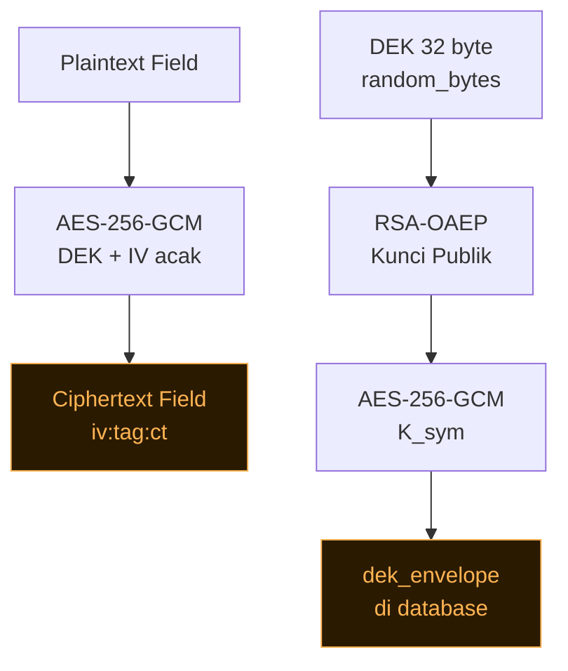
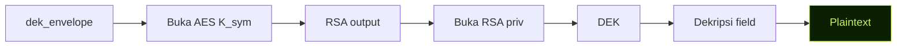
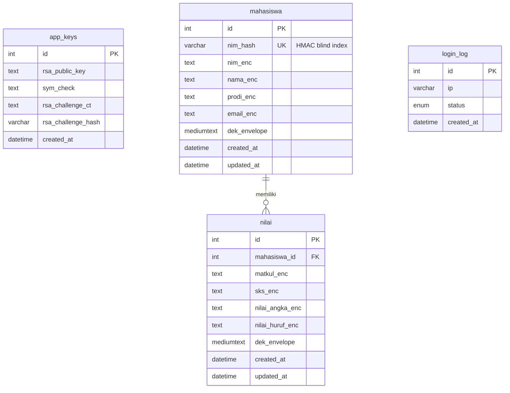

# CipherCampus

Sistem informasi data mahasiswa & nilai dengan enkripsi hybrid **AES-256-GCM + RSA-2048**. Login menggunakan dua kunci kriptografi (bukan username/password).

**Proyek UTS — Sistem Informasi** | Dikerjakan dengan PHP Native + MySQL (Laragon)

---

## Fitur

- 🔐 **Login 2 Kunci**: K_sym (256-bit hex) + Kunci Privat RSA-2048 (PEM)
- 🗄️ **CRUD Terenkripsi**: Tambah, ubah, hapus mahasiswa & nilai — semua field sensitif dienkripsi AES-256-GCM
- 👁️ **Toggle Ciphertext/Plaintext**: Lihat data terenkripsi atau dekripsi on-demand dengan animasi
- 🔬 **Crypto Inspector**: Visualisasi alur enkripsi (IV, tag, ciphertext, envelope) per baris
- 🛡️ **Verifikasi Integritas**: Tag GCM mendeteksi modifikasi data di database
- ⚡ **Seed Data Contoh**: Isi ±8 mahasiswa dan ±15 nilai dummy langsung dari dashboard

---

## Cara Instalasi di Laragon

### Prasyarat
- Laragon versi 6+ (Apache + PHP 8.0+ + MySQL)
- Ekstensi PHP: `openssl`, `pdo_mysql` (sudah aktif di Laragon by default)

### Langkah

1. **Clone atau salin folder** ke `C:\laragon\www\ciphercampus`

2. **Import database** via phpMyAdmin:
   - Buka `http://localhost/phpmyadmin`
   - Klik "Import" → pilih file `database/ciphercampus.sql` → klik "Go"

3. **Sesuaikan konfigurasi** (opsional, default sudah sesuai Laragon):
   ```php
   // includes/config.php
   define('APP_AUTHOR', 'Nama Anda');
   define('APP_NIM',    'NIM Anda');
   define('DB_PASS', ''); // kosong untuk Laragon default
   ```

4. **Jalankan** di browser:
   - Pastikan Laragon sudah running (klik Start All)
   - Buka `http://localhost/ciphercampus`

5. **Setup kunci** (pertama kali):
   - Klik "Mulai Setup Kunci" atau buka `http://localhost/ciphercampus/setup.php`
   - Klik "Generate Kunci Sekarang"
   - **Simpan** K_sym (64 hex) dan **unduh** `ciphercampus-private.pem`
   - Centang konfirmasi → klik "Lanjut ke Login"

6. **Login**:
   - Paste K_sym di kolom "Kunci Simetris"
   - Paste isi .pem **atau** upload file .pem
   - Klik "Masuk ke Admin"

---

## Cara Pakai

### Tambah Data
- Dashboard → "Tambah Mahasiswa" / "Tambah Nilai"
- Atau gunakan "Isi Data Contoh" untuk demo cepat (8 mahasiswa + 15 nilai)

### Melihat Data
- Halaman Mahasiswa / Nilai → data tampil sebagai **ciphertext** by default
- Toggle "Plaintext" untuk mendekripsi on-demand (animasi scramble → teks asli)

### Crypto Inspector
- Dashboard → "Crypto Inspector" → pilih tabel & ID baris
- Lihat setiap komponen: IV (12 byte), tag GCM (16 byte), ciphertext, dek_envelope

---

## Diagram Alur Enkripsi





## ERD



---

## Skema Kriptografi

### Enkripsi (Simpan Data)
1. Generate **DEK** = `random_bytes(32)` unik per baris
2. Tiap field: `AES_256_GCM(DEK, IV_acak)` → format `iv:tag:ct`
3. DEK dibungkus: `RSA_OAEP(pub_key, DEK)` → lalu `AES_256_GCM(K_sym, rsa_output)` → `dek_envelope`
4. Blind index NIM: `HMAC_SHA256(derived_key, NIM)`

### Dekripsi (Baca Data)
1. Buka `dek_envelope`: `AES_256_GCM(K_sym, ...)` → dapat RSA output
2. `RSA_OAEP(priv_key, rsa_output)` → dapat DEK
3. `AES_256_GCM(DEK, iv, tag, ct)` → plaintext (gagal jika dimodifikasi)

### Login (Verifikasi 2 Kunci)
1. **Simetris**: dekripsi `sym_check` dengan K_sym → bandingkan dengan magic string
2. **Asimetris**: dekripsi RSA challenge dengan kunci privat → bandingkan hash
3. Login berhasil hanya jika keduanya lolos. Pesan error generik.

### Catatan Teknis Jujur
- **OAEP SHA-1**: PHP menggunakan SHA-1 untuk RSA-OAEP (bawaan). Di produksi, SHA-256 lebih dianjurkan.
- **Kunci di Session**: K_sym dan kunci privat disimpan di `$_SESSION` selama sesi. Ini kompromi edukasi.
- **Kehilangan Kunci**: Jika K_sym atau kunci privat hilang, **data tidak bisa dibuka kembali**.

---

## Struktur Folder

```
ciphercampus/
├── index.php              # Landing page publik
├── login.php              # Login 2 kunci
├── setup.php              # Generate kunci (sekali pakai)
├── logout.php
├── admin/
│   ├── dashboard.php      # Statistik + aksi cepat
│   ├── mahasiswa.php      # CRUD mahasiswa
│   ├── nilai.php          # CRUD nilai
│   └── inspector.php      # Crypto Inspector
├── api/
│   ├── decrypt.php        # Dekripsi on-demand (JSON API)
│   └── seed.php           # Isi data contoh
├── includes/
│   ├── config.php         # Konfigurasi & konstanta
│   ├── db.php             # PDO singleton
│   ├── crypto.php         # class CryptoService
│   ├── auth.php           # Login, guard, CSRF, rate limit
│   └── layout.php         # Komponen header/sidebar/footer
├── assets/
│   ├── css/main.css       # Stylesheet utama (dark-first)
│   ├── js/main.js         # JavaScript (tema, modal, dekripsi UI)
│   └── img/favicon.svg
├── database/
│   └── ciphercampus.sql   # Skema DB siap import
├── tests/
│   └── crypto_test.php    # Test CLI (php tests/crypto_test.php)
├── docs/
│   └── penjelasan-kriptografi.md
├── .gitignore
└── README.md
```

---

## Troubleshooting

### OpenSSL gagal generate kunci di Windows/Laragon
```
Pastikan path openssl.cnf benar. Edit OPENSSL_CNF_PATH di includes/config.php
atau set environment variable OPENSSL_CONF sebelum menjalankan PHP.
```

### Ekstensi PHP belum aktif
```
Buka C:\laragon\bin\php\php-X.X.X\php.ini
Pastikan baris berikut TIDAK dikomentari (hapus titik koma di depan):
  extension=openssl
  extension=pdo_mysql
Restart Laragon.
```

### Reset kunci (data lama tidak bisa dibaca lagi)
```sql
-- Di phpMyAdmin, jalankan:
TRUNCATE TABLE app_keys;
TRUNCATE TABLE mahasiswa;
TRUNCATE TABLE nilai;
-- Lalu buka setup.php lagi
```

### Pesan "Data rusak / telah dimodifikasi"
Data di database telah diubah secara manual atau kunci yang digunakan tidak sama dengan yang mengenkripsi.

---

## Menjalankan Test
```bash
php tests/crypto_test.php
```
Harus output semua ✓ tanpa ✗.

---

## Keterbatasan Diketahui

1. Pencarian hanya berdasarkan ID; teks tidak bisa dicari langsung (data terenkripsi)
2. RSA-OAEP menggunakan SHA-1 (bawaan PHP) — cukup untuk edukasi
3. Kunci privat ada di `$_SESSION` — tidak untuk produksi
4. Tidak ada fitur multi-user / manajemen peran
